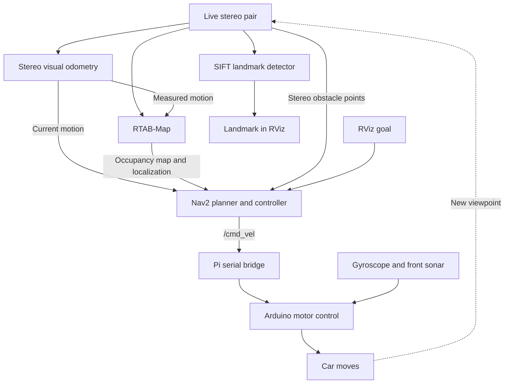

# ROS 2 robot car roadmap

## Demo

Drive the car around a room to build a map. Restart in localization mode, select a destination in RViz, and have Nav2 drive there. At arrival, show the existing SIFT detector recognizing a known landmark. Demonstrate the workflow in Gazebo and on the real car.

## Architecture

- Use the car's existing live stereo pair, Raspberry Pi, Arduino, IMU, and sonar. The car has no wheel encoders.
- Target Ubuntu 22.04 (Jammy) and ROS 2 Humble on the development laptop. Use Gazebo Fortress for simulation.
- Run stereo capture and the serial bridge on the Pi. Run visual odometry, RTAB-Map, Nav2, SIFT, and RViz on a workstation initially. Gazebo provides equivalent sensor and motion interfaces for simulation.
- Stereo odometry owns `odom → base_link`. RTAB-Map owns `map → odom`, builds the map during teleoperation, and reloads it for localization. The robot description provides sensor mounting transforms.
- Start with NavFn A* and Regulated Pure Pursuit. Give Nav2 a measured footprint and live stereo obstacle data. The Arduino handles gyro feedback, a front-sonar stop, and a command timeout.
- Preserve the original discrete Bayes filter as a marked-grid replay experiment, comparing the estimated cell with the observed cell. Credit the original team in the demo and repository.

## Milestones

| Milestone | Verification |
| --- | --- |
| 1. Stereo capture and odometry | Record synchronized, calibrated stereo images while manually rolling the car along a measured line. Replay them and compare estimated motion with measured travel. |
| 2. Base control | Teleoperate straight lines and arcs. Verify that expired commands and loss of the serial connection stop the car. |
| 3. Mapping and localization | Drive a loop, save the map, restart at a marked spot, and compare the estimated pose with the actual pose. |
| 4. Navigation | Send a goal from RViz, follow the planned route, and test the response to an obstacle. |
| 5. Demonstration | Show landmark recognition at arrival in simulation and on the car. Publish a replayable recording, simulation instructions, and goal success and final position error over five runs. |

Planning is recorded. No implementation milestone has been verified. The first suggested feature is **live stereo capture and recording**, the first part of milestone 1.
